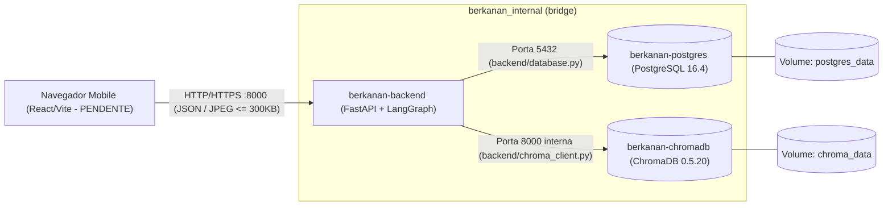

# Arquitetura de Deploy, Containerização e Requisitos Mobile First

> **Responsável:** Caio Soares de Andrade (**R6 — Engenheiro DevOps** / **R7 — Engenheiro MLOps**)  
> **Data de referência:** 14/11/2026  

Este documento detalha a infraestrutura de containers implementada para o **Challenge 2 Berkanan**, diferenciando o que já está operacional na camada de infraestrutura do que permanece pendente de integração pelas frentes de Backend (R5), Arquitetura (R2) e Dados (R4).

---

## 1. Topologia de Containers (`compose.yaml`)

### 1.1 Serviços Configurados

| Serviço | Imagem / Build | Porta Interna | Porta Host (padrão local) | Volume Persistente | Status da Integração no Código |
|---|---|---|---|---|---|
| `backend` | Build local (`./backend/Dockerfile`, base `python:3.12.7-slim-bookworm`) | `8000` | `127.0.0.1:8000` | Sem estado (stateless) | `IMPLEMENTADO` (esqueleto `main:api` com `POST /api/analyze`, `/health`, telemetria) |
| `postgres` | `postgres:16.4-alpine` | `5432` | `127.0.0.1:5432` | `postgres_data` | `IMPLEMENTADO` (migrações 001–004 montadas em `/docker-entrypoint-initdb.d`, `database.py`) |
| `chromadb` | `chromadb/chroma:0.5.20` | `8000` | `127.0.0.1:8001` | `chroma_data` | `IMPLEMENTADO` (`chroma_client.py`, `scripts/ingest_chroma.py`, coleção `base_conhecimento_v1`) |
| `frontend` | *Não incluído ainda* | — | — | — | `PENDENTE` (será adicionado quando R5 entregar o projeto React/Vite) |

> [!NOTE]
> **Integração de Dados (Handoff R4):** As migrações 001–004 (`migrations/`) e os módulos de dados no backend conectam a API FastAPI tanto à Feature Store relacional (PostgreSQL) para cálculos exatos e telemetria quanto à Feature Store vetorial (ChromaDB) para citações RAG.

---

## 2. Boas Práticas Aplicadas no `backend/Dockerfile`

1. **Imagem explícita e enxuta:** `python:3.12.7-slim-bookworm`.
2. **Sem bibliotecas pesadas prematuras:** Não foram incluídas dependências de sistema do Tesseract ou PaddleOCR no container enquanto o benchmark da Semana 4 (ADR-002) não definir a ferramenta vencedora.
3. **Execução sem privilégios de root:** O processo Uvicorn roda sob o usuário dedicado `appuser` (`UID 10001`, `GID 10001`).
4. **Preservação do contrato de inicialização:** Executa exatamente `uvicorn main:api --host 0.0.0.0 --port 8000`, mantendo o nome `api` exportado em `backend/main.py`.
5. **Healthcheck nativo:** Verifica `http://127.0.0.1:8000/openapi.json` usando a biblioteca padrão `urllib.request` do Python, evitando instalar `curl` ou `wget` apenas para checagem de saúde.

---

## 3. Preparação de Infraestrutura para Requisitos Mobile First

A aplicação Berkanan tem como público-alvo consumidores utilizando navegadores de smartphones em supermercados (redes móveis 4G/5G instáveis). Embora a interface React e o pipeline OCR sejam de responsabilidade de R5/R4, a infraestrutura deve observar os seguintes requisitos:

### 3.1 Obrigatoriedade de HTTPS para Câmera no Navegador Mobile
- Navegadores móveis modernos (Chrome no Android, Safari no iOS) bloqueiam o acesso direto à câmera via `navigator.mediaDevices.getUserMedia()` em origens inseguras (`http://`), exceto em `localhost`.
- **Requisito para testes em celulares reais e deploy (Semana 5):** O endpoint público ou túnel de homologação deverá obrigatoriamente terminar conexões em **HTTPS (TLS)** (via proxy reverso como Caddy/Nginx ou túnel HTTPS seguro durante testes de campo).

### 3.2 Limites de Upload e Compressão no Dispositivo (ADR-002)
- O celular realiza o recorte e a compressão antes do envio:
  - **Resolução alvo:** ~1280 pixels no maior lado;
  - **Formato:** JPEG;
  - **Tamanho alvo:** até **300 KB** (`MAX_UPLOAD_BYTES=307200` documentado em `.env.example`).
- Quando o endpoint de upload/OCR for integrado em `backend/main.py`, a API e/ou o proxy reverso deverão rejeitar payloads excessivamente grandes (ex.: fotos brutas de 10–15 MB não comprimidas) para proteger a memória do container e respeitar a meta de **latência mediana ≤ 10 s no 4G**.

### 3.3 Privacidade, LGPD e Política de Logs (ADR-008)
- **Proibição de registro sensível:** O backend e os containers **nunca** devem imprimir o conteúdo de `image_base64` nem associar `user_profile` (`has_diabetes`, `has_hypertension`) a identificadores pessoais nos logs do Docker (`stdout`/`stderr`) ou na tabela `metricas_requisicao`.
- As imagens enviadas para extração devem ser processadas em memória (ou arquivo temporário efêmero imediatamente descartado) sem armazenamento permanente sem consentimento explícito.

### 3.4 Roteiro para Testes em Redes Móveis (Semana 5)
1. Validar tempo de upload de imagens JPEG de 150 KB a 300 KB sob perfil de rede 4G simulado (Chrome DevTools Network Throttling: *Fast 4G* / *Regular 4G*) e em aparelho físico.
2. Registrar na tabela `metricas_requisicao` (PostgreSQL) a latência separada por etapa (OCR, RAG, Agentes, Verificador) para verificar se a mediana permanece **≤ 10 segundos**.
