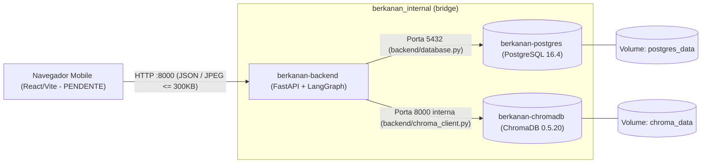
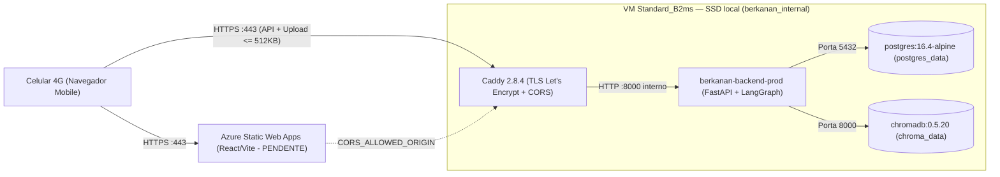

# Arquitetura de Deploy, Containerização e Requisitos Mobile First

> **Responsável:** Caio Soares de Andrade (**R6 — Engenheiro DevOps** / **R7 — Engenheiro MLOps**)  
> **Última atualização:** 24/11/2026  

Este documento detalha a infraestrutura de containers implementada para o **Challenge 2 Berkanan**, tanto para desenvolvimento local ([compose.yaml](../../compose.yaml)) quanto para a proposta de implantação híbrida enxuta na **Microsoft Azure (`brazilsouth`)** ([ADR-009 proposto](../adr/adr_009.md)), diferenciando o que está operacional daquilo que aguarda entrega ou decisão das demais frentes.

---

## 1. Topologia de Containers Local (`compose.yaml`)



### 1.1 Serviços Locais Configurados

| Serviço | Imagem / Build | Porta Interna | Porta Host (padrão local) | Volume Persistente | Status da Integração no Código |
|---|---|---|---|---|---|
| `backend` | Build local (`./backend/Dockerfile`, base `python:3.12.7-slim-bookworm`) | `8000` | `127.0.0.1:8000` | Sem estado (stateless) | `IMPLEMENTADO` (`main:api`, `/health`, `/api/analyze`, agente nutricional + RAG + Config. C + OCR pytesseract + `llm_calls` via PR #40) |
| `postgres` | `postgres:16.4-alpine` | `5432` | `127.0.0.1:5432` | `postgres_data` | `IMPLEMENTADO` (migrações `001`–`011` montadas em `/docker-entrypoint-initdb.d`, `database.py`) |
| `chromadb` | `chromadb/chroma:0.5.20` | `8000` | `127.0.0.1:8001` | `chroma_data` | `IMPLEMENTADO` (`chroma_client.py`, `scripts/ingest_chroma.py`, coleção `base_conhecimento_v2`) |
| `frontend` | *Não incluído ainda* | — | — | — | `PENDENTE` (aguardando entrega React/Vite por R5) |

---

## 2. Topologia Híbrida Enxuta na Azure (`infra/azure/` — ADR-009 Proposto)

Para viabilizar os testes em celulares reais via 4G (câmera exige HTTPS) e a avaliação com usuários (#34) com baixa complexidade operacional, a stack de staging/produção utiliza uma **VM Linux em `brazilsouth`** (`Standard_B2ms`, SSD local) combinada com **Azure Static Web Apps (`Free`)**:



### 2.1 Por que VM + Caddy + SSD local em vez de Azure Files (SMB)?
- O **ChromaDB 0.5.20** armazena metadados em SQLite local. Volumes SMB (Azure Files) têm problemas conhecidos de locks com SQLite sob escrita/reindexação. O disco SSD local da VM garante estabilidade para `chroma_data` e `postgres_data`.
- O **Caddy** entrega certificados **TLS automáticos (Let's Encrypt)** para o FQDN da Azure (`*.brazilsouth.cloudapp.azure.com`), aplica limite de tamanho de requisição na borda (`CADDY_MAX_BODY_SIZE=512KB`) e controla cabeçalhos CORS.
- As portas `5432`, `8000` e `8001` permanecem **bloqueadas** no Network Security Group (`infra/azure/provision_azure_cli.sh`).

### 2.2 Passo a Passo de Provisionamento e Deploy na Azure

> **Guia operacional detalhado:** consulte o playbook completo em [infra/azure/PLAYBOOK.md](../../infra/azure/PLAYBOOK.md) para ajustes de `Dockerfile` após os merges de #40/#24/frontend, orçamento de RAM na VM `Standard_B2ms`, validação de DNS, backup `pg_dump` e troubleshooting.

1. **Provisionar infraestrutura base na Azure** (revise em `--dry-run` antes de aplicar):
   ```bash
   ADMIN_CIDR="SEU_IP_PUBLICO/32" bash infra/azure/provision_azure_cli.sh --dry-run
   ADMIN_CIDR="SEU_IP_PUBLICO/32" bash infra/azure/provision_azure_cli.sh --apply
   ```
2. **Na VM Azure (`brazilsouth`), preparar o ambiente:**
   - Instalar Docker Engine + Docker Compose plugin e clonar o repositório em `AZURE_DEPLOY_PATH` (ex.: `/opt/berkanan/Challenge2_berkanan`).
   - Copiar e preencher os segredos reais:
     ```bash
     cp infra/azure/.env.prod.example infra/azure/.env.prod
     # Editar POSTGRES_PASSWORD, GEMINI_API_KEY, API_DOMAIN e CORS_ALLOWED_ORIGIN
     ```
3. **Executar o bootstrap idempotente:**
   ```bash
   bash infra/azure/bootstrap_stack.sh
   ```
   O script:
   - Valida que não há senhas padrão (`CHANGE_ME_*` / `dev_only_change_me`);
   - Sobe `postgres` e `chromadb`;
   - Executa `migrations/migrate.sh` com `SEED=0` (aplicando qualquer migração nova mesmo em volume existente);
   - Verifica se a coleção `${CHROMA_COLLECTION}` possui chunks e, se necessário (ou se `FORCE_REINDEX=1`), executa `scripts/ingest_chroma.py`;
   - Sobe `backend` e `caddy` e valida `GET /health`.
4. **Deploy contínuo controlado e rollback (`.github/workflows/deploy-azure.yml`):**
   - Configure no GitHub Environment `azure-staging` os secrets `AZURE_VM_HOST`, `AZURE_VM_USER`, `AZURE_VM_SSH_KEY` e `AZURE_DEPLOY_PATH`.
   - Dispare manualmente em *Actions → Deploy Azure Staging* (`workflow_dispatch`). Em caso de falha no bootstrap, o workflow reverte automaticamente para o commit Git anterior (`PREV_SHA`) e reexecuta `bootstrap_stack.sh`.

---

## 3. Boas Práticas Aplicadas no `backend/Dockerfile`

1. **Imagem explícita e enxuta:** `python:3.12.7-slim-bookworm`.
2. **Execução sem privilégios de root:** processo Uvicorn sob o usuário dedicado `appuser` (`UID 10001`, `GID 10001`).
3. **Preservação do contrato de inicialização:** `uvicorn main:api --host 0.0.0.0 --port 8000`.
4. **Healthcheck nativo:** verifica `http://127.0.0.1:8000/openapi.json` via `urllib.request`.
5. **Nota de otimização R6/R7 (em coordenação com PR #40):** quando as dependências de OCR/embeddings entrarem na `main`, manter wheel CPU-only para evitar pacotes CUDA desnecessários na imagem de produção.

---

## 4. Requisitos Mobile First, Privacidade e Testes em 4G

- **HTTPS obrigatório:** `navigator.mediaDevices.getUserMedia()` exige origem segura (`https://`) fora de `localhost`.
- **Compressão no cliente (ADR-002):** ~1280 px no maior lado, JPEG, até ~300 KB (`MAX_UPLOAD_BYTES=307200` no backend e `CADDY_MAX_BODY_SIZE=512KB` no proxy).
- **Privacidade e LGPD (ADR-008):** nunca registrar `image_base64` nem associar `user_profile` a identificadores pessoais nos logs do Docker/Caddy ou na tabela `metricas_requisicao`.
- **Roteiro de validação 4G:** validar upload de 150–300 KB sob perfil *Fast 4G* / *Regular 4G* e conferir na view `vw_checagem_limiares_monitoramento` se a latência mediana permanece **≤ 10 s**.
