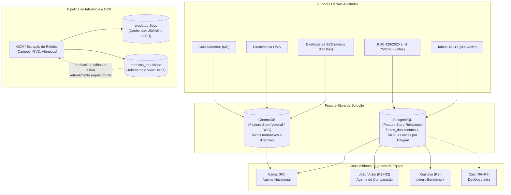

# Desafio 2: Escolhas Alimentares a partir do Rótulo Nutricional
## Documento Oficial de Engenharia de Dados (Papel R4)
**Equipe:** Berkanan  
**Responsável (R4):** Davi Rodrigues (Engenheiro de Dados)  
**Líder (R3):** Gustavo  
**Equipe de Desenvolvimento:** João Victor (R1+R2), Carlos (R5), Caio (R6+R7)  
**Data de Referência:** 13/11/2026  
**Revisão:** 14/11/2026 (correções listadas na Seção 7)  

---

## 1. Identificação e Contexto do Projeto
No âmbito do Desafio 2 da disciplina, a **Equipe Berkanan** desenvolve uma solução multiagente para apoio a escolhas alimentares conscientes a partir de rótulos nutricionais.

O papel do **R4 (Davi Rodrigues - Engenheiro de Dados)** é estruturado com base estrita no **CLAUDE.md** e no **PDF "Desafio 2: Contexto do projeto"**:
1. Curadoria das **5 fontes oficiais** listadas nos materiais (cadastradas em 6 registros, porque RDC 429 e IN 75 ficam separadas no banco): Guia Alimentar, RDC 429 e IN 75, TACO, OMS e SBD (com uso restrito a avisos para pessoas com diabetes, conforme documento já usado no Desafio 1).
2. Arquitetura e sustentação da **Feature Store híbrida** (ChromaDB para recuperação vetorial/RAG e PostgreSQL para dados relacionais exatos por 100 g/ml).
3. Pipeline de normalização por 100 g/ml, extração de nutrientes, %VD e linha "ALÉRGICOS", com checagens de consistência que constam no CLAUDE.md.
4. Cache de produtos lidos (`produtos_lidos`) com proteção estrita de privacidade (LGPD: sem fotos nem perfil de saúde sem consentimento) e respeito à **Regra nº 6** (nunca afirmar "livre de alergênicos").
5. Telemetria e consolidação diária de métricas de requisições (`metricas_requisicao`), aprovada em 13/11, alimentando o feedback para as regras de extração do R4 (sem Prometheus, sem alertas).
6. Estrutura de migrações numeradas e idempotentes na pasta `migrations/` para o **Caio** (DevOps / Infra) recriar o banco em dev e produção.

---

## 2. ETAPA 1: Mapeamento do Papel (R4 Davi Rodrigues)

### 2.1. Citação Literal da Seção 9 do PDF

A linha do R4 na tabela da Seção 9 do PDF do professor estabelece textualmente:
- **Coluna "O que o material atribui":** *"Localizar fontes e analisar qualidade; regras de transformação e limpeza; pipeline até a feature store"*
- **Coluna "Aplicação no projeto":** *"Fontes oficiais; regras de extração do texto do OCR; carga do ChromaDB e do PostgreSQL"*

> [!NOTE]
> O texto mais longo sobre o R4 (*"Localiza e avalia a qualidade das fontes de dados, define regras de transformação e limpeza e desenvolve os pipelines..."*) vem da resposta 1 do João (R1+R2) às perguntas do material do professor, e está de acordo com as frases acima.

---

### 2.2. Matriz de Entregas Concretas, Prazos e Dependentes

| Parte do papel (PDF Seção 9) | O que o material atribui (PDF Seção 9) | Aplicação no projeto / Entrega concreta | Prazo (data real) | Fonte | Quem depende |
| :--- | :--- | :--- | :--- | :--- | :--- |
| **Ingestão e Análise de Fontes** | Localizar fontes e analisar qualidade | Fontes oficiais: baixar e conferir versões, links e integridade das 5 fontes (Guia Alimentar, RDC 429 e IN 75, TACO, OMS e SBD; 6 registros) em `001_fontes.sql` | **12/11/2026** *(Atrasado)* | PDF Seção 9 / CLAUDE.md | Gustavo (R3), João Victor (R1+R2), Carlos (R5) |
| **Pipeline e Feature Store** | Pipeline até a feature store | Carga do ChromaDB e do PostgreSQL (TACO e limites da rotulagem em `002_taco_limites.sql`) | **13/11/2026** *(Atrasado)* | PDF Seção 9 / CLAUDE.md | Carlos (R5), João Victor (R1+R2), Gustavo (R3), Caio (R6+R7) |
| **Regras de Transformação e OCR** | Regras de transformação e limpeza | Regras de extração do texto do OCR (campos da tabela nutricional, %VD, linha "ALÉRGICOS", conversão por 100 g) e checagens | **22/11/2026** *(Semana 4)* | PDF Seção 9 / CLAUDE.md | João Victor (R1+R2), Carlos (R5), Gustavo (R3) |
| **Cache Operacional e LGPD** | Pipeline até a feature store | Tabela de cache de produtos lidos (`003_cache.sql`) com porção, %VD em JSONB, texto de ALÉRGICOS e conformidade LGPD | **22/11/2026** *(Semana 4)* | CLAUDE.md / Chat 13/11 | Caio (R6+R7), Carlos (R5), João Victor (R1+R2) |

*Data limite de entrega final do projeto consolidado:* **07/12/2026**.

---

### 2.3. A Feature Store Híbrida e o Loop de Feedback de Monitoramento

1. **Feature Store Híbrida (ChromaDB + PostgreSQL):**
   - **ChromaDB (Vetorial):** Armazena trechos textuais e embeddings das normas para recuperação semântica context-aware via RAG, fornecendo justificativas qualitativas aos agentes.
   - **PostgreSQL (Relacional):** Persiste dados centesimais (TACO) e parâmetros regulatórios (IN 75/2020) padronizados estritamente por **100 g / 100 ml**, garantindo determinismo aritmético e conformidade regulatória.
2. **Loop de Feedback do Monitoramento:**
   - Falhas de leitura registradas em `metricas_requisicao` alimentam diretamente a revisão e o versionamento das regras de extração do R4.

---

## 3. ETAPA 2: Planilha de Gestão (`papel_R4_davi.xlsx`)
Arquivo: `papel_R4_davi.xlsx`

### 3.1. Aba "Papel R4"
- **Colunas:** `Parte do papel`, `O que o material atribui (PDF Seção 9)`, `Entrega no projeto (PDF Seção 9 / Cronograma)`, `Prazo (data real)`, `Semana`, `Fonte`, `Dependentes`, `Status`.
- **Texto da Seção 9:** Preenchido rigorosamente com as frases literais do PDF.
- **Formatação Condicional:** A célula de prazo de 12/11/2026 está destacada em vermelho suave (`#FFC7CE` com texto `#9C0006`) por estar vencida com status diferente de "Concluído" (data de hoje: 13/11/2026).
- **Lista Suspensa:** Validação de dados na coluna `Status` (`H2:H5`) com as opções: `A fazer`, `Em andamento`, `Concluído`.
- **Filtro e Visual:** AutoFilter em `A1:H5`, congelamento de painel em `A2`, tipografia Arial, cabeçalho azul escuro (`#1F4E78`) com texto branco em negrito.
- **Resumo com Fórmulas:**
  - `=COUNTIF(H2:H5, "A fazer")` $\rightarrow$ 4
  - `=COUNTIF(H2:H5, "Em andamento")` $\rightarrow$ 0
  - `=COUNTIF(H2:H5, "Concluído")` $\rightarrow$ 0
  - `=SUM(B8:B10)` $\rightarrow$ Total: 4
  *(Fórmulas testadas e recalculadas sem erros).*

### 3.2. Aba "Notas"
- **Tópico 1 - Feature Store = ChromaDB + PostgreSQL:** Carga das bases estruturadas e vetoriais conforme Seção 9 do PDF e decisões do CLAUDE.md.
- **Tópico 2 - Feedback do Monitoramento:** Telemetria aprovada em 13/11 retroalimentando as regras de OCR do R4.
- **Tópico 3 - Rastreabilidade de Regras:** Mapeamento explícito de que açúcares totais $\le$ carboidratos, energia $\approx$ 4×carboidratos + 4×proteínas + 9×gorduras, Regra nº 6 e LGPD constam no material, enquanto propostas adicionais foram rotuladas como sugestões não aprovadas.

---

## 4. ETAPA 3: Esquema PostgreSQL (Migrações Numeradas na pasta `migrations/`)

### 4.1. `001_fontes.sql` - Tabela `fontes_documentos`
- **Arquivo:** `migrations/001_fontes.sql`
- **Estrutura:** `id` (SERIAL PK), `documento`, `orgao`, `versao`, `link`, `data_download` (DEFAULT '2026-11-12'), `conferido_por` (DEFAULT 'Davi Rodrigues (R4)'), `hash_arquivo`, `status_conferencia` (`pendente_conferencia`, `conferido`, `obsoleto`), `observacoes`.
- **Carga das 5 fontes oficiais, em 6 registros** (RDC 429 e IN 75 são uma fonte só no CLAUDE.md, mas ficam separadas porque os limites vêm da IN 75):
  1. Guia Alimentar para a População Brasileira (2ª ed., 2014) - Ministério da Saúde
  2. RDC nº 429/2020 - ANVISA
  3. IN nº 75/2020 - ANVISA
  4. Tabela TACO - NEPA / Unicamp
  5. Diretrizes sobre açúcares e sódio - OMS
  6. Diretrizes da Sociedade Brasileira de Diabetes (SBD) - uso restrito a avisos para pessoas com diabetes (documentos já usados no Desafio 1)
- **Chaves estrangeiras:** quem aponta para esta tabela busca o id pelo nome do documento (ex.: `(SELECT id FROM fontes_documentos WHERE documento = 'IN 75/2020')`), nunca por número fixo.
- *Nota de rastreabilidade:* O campo `hash_arquivo` foi documentado como **SUGESTÃO do Davi, não aprovada pelo grupo (não consta no material)**.

### 4.2. `002_taco_limites.sql` - Tabelas `taco_alimentos` e `limites_rotulagem`
- **Arquivo:** `migrations/002_taco_limites.sql`
- **`taco_alimentos`:**
  - `codigo_taco` (PK), `fonte_id` (FK para `fontes_documentos.id`), `nome`, `grupo`, `energia_kcal`, `energia_kj`, `proteina_g`, `lipidios_g`, `saturados_g`, `carboidrato_g`, `fibra_g`, `sodio_mg` (todos por 100 g).
  - **Tratamento de Nulos:** "NA" armazenado como `NULL` (não avaliado em laboratório). "Tr" armazenado como `NULL` na tabela física.
  - **Consistência Calórica (consta no CLAUDE.md):** Relação aproximada de Atwater: energia $\approx$ 4×carboidratos + 4×proteínas + 9×gorduras.
  - *Sugestões do Davi:* Constraints `saturados_g <= lipidios_g` e `soma de macros <= 100 g` ficam **comentadas (não ativas)** no script, como **SUGESTÃO do Davi, não aprovada pelo grupo (não consta no material)**.
- **`limites_rotulagem`:**
  - `id` (PK), `fonte_id` (FK para `fontes_documentos.id`), `norma`, `categoria` (`sólido` / `líquido`), `nutriente` (`açúcares adicionados`, `gorduras saturadas`, `sódio`), `limite_100g`, `unidade`, `trecho_norma`.
  - **Tabela estritamente vazia:** Conforme CLAUDE.md, os valores vêm do texto da IN 75/2020 e nunca devem ser preenchidos de memória. Apenas INSERT-modelo comentado, com o `fonte_id` da IN 75/2020 buscado pelo nome.

### 4.3. `003_cache.sql` - Tabela `produtos_lidos`
- **Arquivo:** `migrations/003_cache.sql`
- **Campos Principais:**
  - `hash_rotulo` (VARCHAR(64) UNIQUE) para cache (*SUGESTÃO do Davi, não aprovada pelo grupo: formato SHA-256 não consta no material*).
  - `nome_produto`, `categoria` (`sólido` / `líquido`).
  - `porcao_quantidade` e `porcao_unidade` (ex: 30 g, 200 ml).
  - Nutrientes normalizados por 100 g / 100 ml.
  - `valores_porcao_jsonb` e `percentual_vd_jsonb` (JSONB para valores originais por porção e %VD).
  - `alergenicos_texto_bruto` (texto lido da linha "ALÉRGICOS") e `alergenicos_extraidos` (lista extraída).
  - `metodo_extracao`, `versao_regras`, `confirmado_usuario`.
- **Checagens que constam no material (CLAUDE.md, Seção 5.2):**
  - `acucares_totais_100g <= carboidrato_100g` (açúcares totais $\le$ carboidratos): **único CHECK ativo** no banco.
  - Relação aproximada de Atwater: energia $\approx$ 4×carboidratos + 4×proteínas + 9×gorduras: checagem aproximada, fica no código de extração (não é CHECK do banco).
- **Sugestões do Davi:**
  - `acucares_adicionados <= acucares_totais`, `gorduras_saturadas <= gorduras_totais`, `gorduras_trans <= gorduras_totais`, `soma de macros <= 100 g` e `energia <= 900 kcal` ficam **comentadas (não ativas)** no script como **SUGESTÃO do Davi, não aprovada pelo grupo (não consta no material)**.
- **Regras Mandatórias do CLAUDE.md:**
  - **Regra aprovada nº 6:** NUNCA criar campo nem lógica que afirme "livre de alergênicos".
  - **LGPD:** Sem fotos nem perfil de saúde sem consentimento do usuário.

### 4.4. `004_metricas.sql` - Telemetria, Validação e as 10 Métricas Oficiais (CLAUDE.md Seções 5.6, 9, 9.1 e 9.2)
- **Arquivo:** `migrations/004_metricas.sql`
- **`metricas_requisicao`:** Uma linha por requisição, integrando telemetria operacional, metadados de execução e métricas de validação:
  - *Operação e RAG:* `tipo_operacao` ('extracao_ocr', 'chat_nutricional', 'comparacao_produtos', 'benchmark'), `modo_execucao` ('rag' ou 'llm_puro').
  - *Conjunto de Teste (Seção 9.1):* `categoria_teste` (Prefixos A a G) e `id_questao_teste` (ex: 'A01', 'G06').
  - *Telemetria Operacional (Seção 5.6):* `latencia_ms`, `falha_leitura`, `tipo_falha`, `chamadas_llm` (meta média $\le$ 2), `versao_ocr` ('tesseract', 'paddleocr', 'apenas_llm'), `modelo_usado` ('gemini', 'modelo_alternativo', 'regras'), `configuracao_verificador` ('A', 'B', 'C').
  - *Métricas de Validação (Seção 9):* `acerto` (booleano), `fidelidade_pct` (0 a 100%), `recall_top3` (booleano), `recusa_correta` (booleano para fora do escopo), `custo_estimado_usd` (custo por método) e `avaliacao_usuario_nota` (escala 1 a 5).
  - *Sem Prometheus / Sem Alertas:* Monitoramento exclusivamente em PostgreSQL.

- **Views Analíticas Implementadas (Consultas SQL Prontas):**
  1. `vw_metricas_agregadas_diarias`: Acompanhamento diário por tipo de operação (latência mediana via `percentile_cont(0.5)`, média de chamadas LLM e taxa de falhas).
  2. `vw_checagem_limiares_monitoramento`: Checagem por SQL, sem alertas automáticos: limiar aprovado da Seção 5.6 (acerto < 85% ou fidelidade < 90%) e metas da Seção 9 (latência > 10 s, chamadas LLM > 2). Sem dados, as colunas ficam NULL.
  3. `vw_benchmark_rag_vs_llm_puro`: Métrica 1 (Semana 2) comparando o acerto do RAG vs LLM puro e avaliando se o ganho é $\ge$ 15 pontos percentuais.
  4. `vw_benchmark_verificador_abc`: Métrica 5 / Seção 9.2 para o Gustavo (R3), comparando fidelidade, acerto, recusa correta, recall top-3, latência e chamadas LLM entre Config A (sem), Config B (regras) e Config C (LLM).
  5. `vw_decisao_verificador_c_vs_b`: Aplicação exata da regra de corte aprovada (C só fica se ganhar $\ge$ 5 pontos de fidelidade sobre B com $\le$ 3 s de acréscimo na latência). Sem dados de B e C, mostra `SEM_DADOS`.
  6. `vw_benchmark_extracao_ocr`: Métricas 6 e 7 (Semana 4) comparando Tesseract, PaddleOCR e Gemini em acerto da extração (meta $\ge$ 85%), taxa de falhas, latência e custo por foto.
  7. `vw_metricas_por_categoria_teste`: Seção 9.1 consolidando o desempenho do conjunto de 50 questões por categoria (A: Guia Alimentar, B: ANVISA, C: Cálculo ALTO EM, D: Comparação, E: Alergênicos, F: Saúde/OMS, G: Fora do escopo).
  8. `vw_avaliacao_usuarios`: Métrica 10 (Semana 6) consolidando a nota média de clareza e utilidade (meta $\ge$ 4 de 5) e distribuição de notas.
  9. `vw_painel_consolidado_10_metricas`: Painel executivo consolidando o status de cumprimento de todas as 10 metas do CLAUDE.md.

### 4.5. `seeds/seed_exemplo.sql` - Dados de Exemplo para Testes (só dev)
- **Arquivo:** `migrations/seed_exemplo.sql`
- Insere exatamente 2 linhas fictícias na TACO marcadas como `[EXEMPLO FICTÍCIO]` com FK para a TACO (id buscado pelo nome do documento), permitindo que Gustavo e João Victor testem seus códigos imediatamente.
- Fica fora de `migrations/` para não entrar em produção. Só é aplicado com `SEED=1 ./migrations/migrate.sh`.

---

## 5. ETAPA 4: Teste das Migrações

Executado em 14/11/2026 num PostgreSQL 16 de teste (revisão do líder), com o próprio `migrate.sh`:
- As 4 migrações rodam sem erro; rodar de novo pula todas (idempotente).
- Sem `SEED=1`, o seed não é aplicado; com `SEED=1`, as 2 linhas fictícias entram apontando para a TACO.
- Sem dados, o painel mostra "Sem dados" e a decisão do verificador mostra `SEM_DADOS`.
- Com B = 80% / 5 s e C = 90% / 7 s, a view decide manter C (regra +5 pts / ≤ 3 s).
- O CHECK açúcares totais ≤ carboidratos bloqueia a linha inválida; as sugestões não aprovadas não bloqueiam nada.

---

## 6. Checklist de Pendências e Alinhamento com os Colegas

### 6.1. O que Ficou Pendente
1. **Conferência das 5 Fontes Oficiais:** Atualizar `fontes_documentos` preenchendo links oficiais verificados e marcando `status_conferencia = 'conferido'`.
2. **Valores Oficiais da IN 75/2020:** Copiar os limites de corte e trechos regulatórios diretamente do texto da IN 75/2020 para o `INSERT` de `limites_rotulagem` (nunca preencher de memória).
3. **Alinhamento com a Planilha "Quadro do Desafio 2":** Conferir a planilha do Drive do grupo para alinhar datas e nomes em `papel_R4_davi.xlsx`.

### 6.2. Nomes de Coluna a Combinar com o João Victor (R1+R2 - Agente de Comparação)
- `energia_kcal` vs. `valor_energetico`
- `proteina_g` vs. `proteinas`
- `carboidrato_g` vs. `carboidratos`
- `lipidios_g` vs. `gorduras_totais`
- `saturados_g` vs. `gorduras_saturadas`
- `sodio_mg` vs. `sodio`
- Confirmar se o agente dele consome os nulos analíticos como `NULL` ou se requer `COALESCE(coluna, 0.0)`.

### 6.3. Nomes de Coluna a Combinar com o Carlos (R5 - Agente Nutricional)
- Confirmar se o agente nutricional lerá o array JSONB `alergenicos_extraidos` para filtrar os alertas aos usuários.
- Alinhar se a classificação de lupas consumirá diretamente `acucares_adicionados_100g`, `gorduras_saturadas_100g` e `sodio_100g` de `produtos_lidos` ou se prefere uma View com flags prontas.

### 6.4. Nomes de Coluna e Infraestrutura a Combinar com o Caio (R6+R7 - DevOps / Infra)
- Confirmar as credenciais e variáveis de ambiente do PostgreSQL para execução do `migrate.sh` (`DB_HOST`, `DB_PORT`, `DB_NAME`, `DB_USER` e a senha via `PGPASSWORD`).
- A tabela de métricas é monitoramento (R6/R7 e ADR-008 do João): combinar com o Caio e o João antes de fechar as colunas.
- Alinhar se a tabela `schema_migrations` do script atende ao pipeline de CI/CD ou se ele prefere migrações gerenciadas por Alembic.

---

## 7. Revisão de 14/11/2026

| # | Problema | Correção |
| :--- | :--- | :--- |
| 1 | Seed com `fonte_id = 3`, que é a IN 75, não a TACO | `fonte_id` buscado pelo nome do documento |
| 2 | INSERT-modelo de `limites_rotulagem` apontava para o id 1 (Guia Alimentar) | `fonte_id` da IN 75 buscado pelo nome |
| 3 | `migrate.sh` aplicava o seed fictício em produção | Seed movido para `seeds/`; só roda com `SEED=1`. O script só aplica arquivos `NNN_*.sql`, e cada migração roda numa transação junto com o registro em `schema_migrations` |
| 4 | Sem dados, o painel mostrava "NÃO ATINGIDA" e a decisão "MANTER_CONFIG_B" | Views retornam NULL / "Sem dados" / `SEM_DADOS` |
| 5 | Documento falava em 5 fontes e o SQL tinha 6 | Explicado: 5 fontes em 6 registros |
| 6 | Checagens não aprovadas estavam ativas no SQL; "adicionados ≤ totais" e "saturadas ≤ totais" apareciam como aprovadas | Só açúcares totais ≤ carboidratos fica ativo; o resto está comentado como sugestão, com o `ALTER TABLE` pronto para ativar se o grupo aprovar |
| 7 | View de limiares falava em "alertas" e citava todos como Seção 5.6 | Comentários corrigidos (Seção 5.6 + Seção 9, sem alertas) |
| 8 | Caminhos locais (`Downloads/...`, `file:///home/...`) | Removidos |

